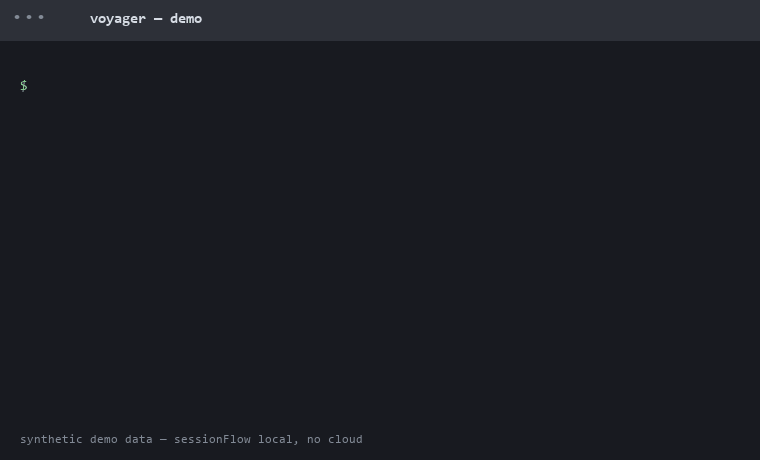
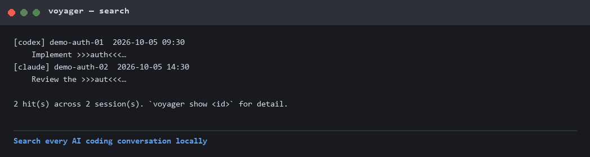
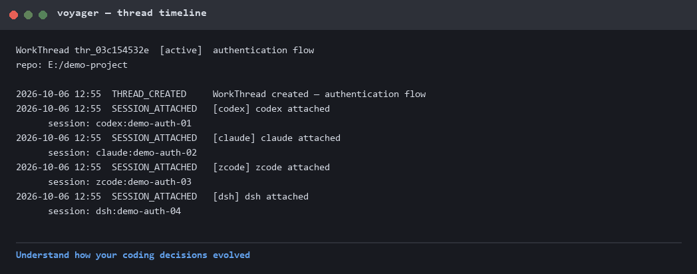
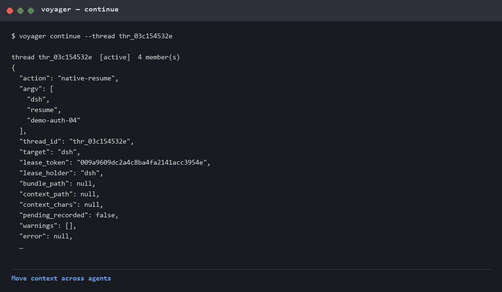

# sessionFlow 🧭

[](https://github.com/HarryHeYu/sessionFlow/actions/workflows/test.yml)
[](https://github.com/HarryHeYu/sessionFlow/releases)
[](https://www.python.org/downloads/)
[](LICENSE)


**面向 AI 编码助手的本地会话索引与跨 Agent 工作接续。**

把你机器上所有 AI 编码 Agent 的会话归并成**一份本地索引**：检索整段编码历史、
查看某个项目的跨 Agent 时间线、把一个 Agent 的工作交给另一个 Agent 而不断线。
全部在本机完成——无账号、无云端、无遥测。

（CLI 命令是 `voyager`；GitHub 仓库叫 sessionFlow。本仓库**不是** DSH 专属——
[DSH 插件](https://github.com/HarryHeYu/dsh-sessionflow)只是它的一个客户端。）

|  |  |
|---|---|
| **是什么** | 在编码 Agent 已经写到磁盘上的会话历史之上，加一层本地索引 + 接续层。 |
| **为什么用** | 你的历史分散在八种格式里。sessionFlow 让它变成一件可以检索、总结、导出、接续的东西——而且接续包里的每一条结论都标着它出自哪个事件，可以核对。 |
| **安装** | `pipx install "voyager[all] @ git+https://github.com/HarryHeYu/sessionFlow.git@v1.3.0"` —— [详见](#安装) |
| **2 分钟试用** | `voyager demo` —— 合成数据，不需要任何 Agent —— [快速上手](#快速上手) · [5 分钟上手指南](docs/QUICKSTART.md) |
| **当前版本** | [v1.3.0](https://github.com/HarryHeYu/sessionFlow/releases/tag/v1.3.0) · Python ≥ 3.10 · Windows / macOS / Linux |
| **已知限制** | Native resume **尚未**端到端验证 —— 见 [支持的平台](#支持的平台) |

### 它主要解决三件事

**换一个 Agent 接着做。** 你在 Codex 里开了一半，想让 Claude Code 接手。
`voyager continue` 会把目标、动过的文件、跑过的命令、报过的错、以及"停在哪一步"
编译成一份上下文包，下一个 Agent 直接读——不用你把一下午重新讲一遍。

**一个项目，好几个会话。** 一个功能散在四个会话、三个 Agent 里。
`voyager merge A B C` 把它们归成一个 WorkThread，`voyager thread summarize <thread>`
给出一份跨 Agent 的简报：谁做了什么、还有哪些没关。

**追一句话的出处。** 交接包里写着"42 个测试全过"。包里每条结论都标着它来自哪个
事件，`voyager evidence verify` 告诉你那条引用是否还落在同一个事件上。它**不**判断
这句话本身是否为真——[见下文](#核对交接包里的说法)。

你的 AI 编码历史是碎片化的：

- Codex 会话（rollout JSONL）
- Claude Code 对话（project JSONL）
- DSH 运行记录（zstd JSONL）
- ZCode / Cursor / Kiro / Grok / Antigravity（SQLite、VSCDB、JSON……）

sessionFlow 把它们归并成**一份本地索引**——纯本地运行，无账号、无云端、
无遥测。

**检索。理解。续接。换 Agent 不丢上下文。**



跨 Agent 接续层已内置：跨会话合并上下文，在任意 Agent 里接着干
（`voyager merge` / `switch` / `continue`）——已交付范围见
[docs/ROADMAP.zh-CN.md](docs/ROADMAP.zh-CN.md)，后续计划见
[docs/POST-1.0.md](docs/POST-1.0.md)。

[English](README.md)

## 和 sessionFlow 一起过一天

```
上午    Codex 实现 SQLite 迁移
下午    Claude Code 审查代码
晚上    DSH 继续调试边界情况

sessionFlow:
  找回当时的推理        -> voyager search "sqlite migration"
  恢复完整上下文        -> voyager continue <thread>
  切到另一个 Agent      -> voyager handoff claude --from codex
```

不会向任何地方上传数据：sessionFlow 只读取各 Agent 已经写好的会话文件，
归一化成一份 SQLite 索引——可搜索、可恢复、可交接，也可以在 Agent 里
通过 MCP 或 DSH 插件直接查询。







以上截图全部由合成演示数据生成（`scripts/make_screenshots.py`）——
README 中没有任何真实用户数据。

## 为什么需要它

每家 Agent 都用自己的格式存历史：Codex 写 rollout JSONL，Claude Code 写
project JSONL 外加一套文件版本链，ZCode 用 SQLite，DSH 用 zstd 压缩的
JSONL。你每天都在跨这些工具干活——Voyager 把这些历史变成**一个**可以查询的东西。

- **多 Agent 统一索引**——8 家 Agent 各写各的格式，归一化成一份 SQLite
  索引；重新扫描是增量的，来源消失时历史被保留（`SOURCE_MISSING`）而非删除。
- **全库全文检索**——找到"那条命令是哪个会话跑的"、"那个文件被谁改过"
  （中文子串搜索可用）；导出为人类可读的 Markdown 或无损 JSON。
- **跨 Agent 时间线与续接**——`continue` / `switch` / `handoff` / `merge`
  生成续接上下文给下一个 Agent；租约机制保证多 Agent 不会盲写同一线程。
- **Doctor 诊断与安全修复**——只读诊断；`--fix` 只执行白名单内的派生数据
  修复，事务性、幂等、支持 dry-run。
- **兼容验证**——provider 能力声明与机器本地证据分离：`declared`（实现
  上限）、`observed`（本机证据）、`effective`（两者取弱），没有证据不抬状态。
- **DSH 集成**——版本化 JSON bridge + MCP server，配套
  [dsh-sessionflow 插件](https://github.com/HarryHeYu/dsh-sessionflow)。

## 安装

```sh
# 用 pipx 装成独立 CLI（推荐，不用折腾虚拟环境）
pipx install "voyager[all] @ git+https://github.com/HarryHeYu/sessionFlow.git@v1.3.0"

# 或者用 pip 装到用户目录（Windows 上用 `python -m pip`，`pip` 常常不在 PATH 里）
python -m pip install "voyager[all] @ git+https://github.com/HarryHeYu/sessionFlow.git@v1.3.0"
```

**Voyager 没有发布到 PyPI。** PyPI 上的 `voyager` 是一个毫不相干的最近邻搜索库，
所以裸跑 `pip install voyager` 会装错项目 —— 请一律使用上面的 `@ git+…` 形式。
改用正式包名的进度见 `CHANGELOG.md`。

`@v1.3.0` 是发布 tag，重装才能装到同一份代码，插件报错信息里推荐的也是它；
去掉 `@v1.3.0` 就是跟 `main` 走。确认装到的版本：

```sh
voyager --version        # 应当输出 1.3.0
```

> **从 v1.2.0（或 v1.1.0）升级不需要迁移。** 索引原样读取：不改任何行，
> 唯一区别是新版本给自己加了一个索引。回滚同样安全——v1.1.0 读同一个库，
> 只是忽略那个多出来的索引。

`[all]` = DSH 支持（`zstandard`）+ MCP server（`mcp`），两者都是可选能力：

```sh
pip install "voyager @ git+https://github.com/HarryHeYu/sessionFlow.git@v1.3.0"          # 核心
pip install "voyager[dsh] @ git+https://github.com/HarryHeYu/sessionFlow.git@v1.3.0"     # + DSH
pip install "voyager[mcp] @ git+https://github.com/HarryHeYu/sessionFlow.git@v1.3.0"     # + MCP server
```

想改 Voyager 本身：

```sh
git clone https://github.com/HarryHeYu/sessionFlow && cd sessionFlow
pip install -e ".[all,dev]"    # 可编辑安装 + 可选依赖 + pytest
python -m pytest tests/ -q     # v1.3.0 上实测：1303 passed / 6 skipped
```

要求 Python ≥ 3.10，Windows / macOS / Linux 均可。如果 `voyager` 不在 PATH 里，
用 `python -m voyager.cli` 运行。

## 核对交接包里的说法

接续包不只是把 Agent 说过的话汇总一遍——每条工具结果、每条助手结论都带着
它出自哪个事件的引用：

```
- `pytest -q`  # exit 1 · seq 2 · #cbd4d070
All 42 tests pass. · seq 3 · #c5009a39
```

`voyager show` 每一行都打印同一个指针，所以可以从一句话走回它背后那条消息。
指针是否还落在同样的内容上，可以直接问：

```sh
voyager evidence verify codex:01ab… 3 c5009a39
```

回答是五种状态之一，并带对应退出码，脚本可以据此分支：

| 状态 | 退出码 | 含义 |
|---|---|---|
| `MATCH` | 0 | 那个位置上的事件，就是当初生成这条引用的事件 |
| `MISMATCH` | 1 | 那个位置上现在是别的事件——引用底下的 transcript 变了 |
| `NOT_FOUND` | 2 | 那个位置没有事件（或没有这个会话） |
| `UNVERIFIABLE` | 3 | 引用里没带 digest，只能核对位置 |
| `INVALID_REFERENCE` | 4 | 引用本身不合法——例如 digest 不是 8 位十六进制 |

`--json` 给出同样的机器可读结果。`voyager evidence verify --help` **不列**这五种
状态和退出码；这张表、命令自己的输出，以及
[上手指南](docs/QUICKSTART.md)里每条状态一个可运行示例，才是它们的出处。

**`MATCH` 是什么意思，不是什么。** 它的意思是"索引里这个事件就是当初那条引用
所指向的事件"。它**不**表示这条结论为真——这里没有任何东西做那个判断——它也不是
签名：指纹只有八位十六进制，改写过 transcript 的人可以重算。来源检查比的是
`mtime` 和 `size`，不等于字节一致。这两条限制写在命令自己的输出里，每条路径都有。

## 快速上手

### 快速演示——不需要装任何 Agent（2 分钟）

`voyager demo` 会生成一份**合成**演示索引：四个 Agent 在一个工作日里
接力完成"authentication flow"。不装 Agent、不用任何真实数据：

```sh
voyager demo
voyager --db ~/.voyager/demo.db search "authentication"   # 命中 2 个 Agent
voyager --db ~/.voyager/demo.db search "JWT refresh token"
voyager --db ~/.voyager/demo.db show codex:demo-auth-01   # 编译好的会话上下文
```

`--db` 是全局参数，放在子命令**之前**（`dashboard` 和 `evidence` 只认这个位置）。

演示索引（`~/.voyager/demo.db`）与真实索引（`~/.voyager/index.db`）相互独立，
随时可删。里面有两点看起来像报错、其实不是：每个会话都标着 `[source missing]`
——demo 的事件只存在于索引里，磁盘上没有对应的 transcript 文件（真实的保留历史
在 provider 轮转文件后也是这个标记：仍可检索，但不可续接）；`show` 每行都带
`#seq/digest`，那就是 Evidence Verify 核对的引用。效果见上面的截图与演示动图。

### 真实使用——索引你自己的 Agent（5 分钟）

**第一次扫描之前请先读这段。** `voyager scan` 会打开你的 Agent 已经写到磁盘上的
会话文件（`~/.codex`、`~/.claude`……），在 `~/.voyager/index.db` 建一份本地索引。
数据不会上传，provider 文件也是只读打开——但那些历史里可能有源码、prompt、
命令输出和文件内容。Dashboard 和每一个接续包都是**从这份索引生成**的，因此会带着
同样的东西：把 `dashboard.html`、`handoff-*.md` 和 `~/.voyager/bundles/` 当作私密
文件，不要贴进 issue 或聊天窗口。

先只扫一个 Agent，而不是全部：

```sh
voyager scan --platform codex    # codex | claude | zcode | dsh，逗号分隔
```

只要本机至少有一个 Agent 留有会话历史：

```sh
voyager scan                # 发现并索引所有支持的 Agent 会话
voyager list                # 全部会话，按更新时间排序
voyager list --repo myproj  # 某个 repo 的会话
voyager show <id>           # 完整时间线：消息 / reasoning / 工具调用 / 退出码
voyager search "tensorboard"
voyager repo E:/code/myproj # 一个 repo 的跨 Agent 时间线
```

`voyager scan` 遍历所有支持的 Agent 的本地存储，在 `~/.voyager/index.db`
建立索引；它是增量的，只重新读取有变化的部分。想让索引零人工保持最新，
可以常驻一个 watcher（用系统自启动配一个自己的启动脚本——voyager 不会替你
安装），每 5 分钟重扫一次：

```sh
voyager watch --interval 300    # 每 5 分钟自动重扫，常驻运行
```

更多命令：

```sh
voyager export <id> --format md   # 或 --format json（含原始事件）
voyager resume <id>         # 调起原 Agent 恢复该会话
voyager handoff <id> --to codex   # 生成给另一个 agent 的上下文包
voyager continue            # 一条命令接着上次干（原生恢复或自动接力）
voyager thread list         # WorkThread：以任务为中心的会话组
voyager switch codex        # 把当前 thread 切到另一个 agent
voyager skill install       # 教其他 agent 认识 voyager
voyager brief               # 最近 48h 所有 agent 在忙什么的摘要
voyager files <id>          # 该会话碰过哪些文件
voyager diff <id>           # Claude 会话：从版本链重建前后 diff
voyager stats               # 索引统计
```

**跨 Agent 接力**是**工作接续**，不是 Session 搬迁（对方拿不到隐藏的
tool state 或 cached reasoning）。`voyager handoff <id> --to codex` 会把
会话提炼成上下文包（目标、指令、碰过的文件、命令、报错、工作停在哪）并给出
启动命令；加 `--launch` 立即启动。目标 agent 被要求读这个文件接着干——
`claude`、`codex`、`grok` 可直接拉起；其他目标给出文件手动粘贴。
同一平台的续聊仍然走原生 resume（`codex resume` 等）。

**一条命令继续**：`voyager continue` 自动挑你最新的会话并做对的事——
codex/claude/dsh/grok 走原生恢复，其余自动生成接力包。它是**写操作，不是读**：
会先刷新索引（对你所有 provider 目录做一次增量扫描）、工作期间占用 WorkThread
租约、并产出一个文件——`--no-launch` 只打印命令不启动，`-o` 决定包写到哪里。
`voyager continue
--repo myproj --launch` 直接回到某个项目的现场。多会话合并已经有了
（`voyager merge A B C` 会把工作聚合成 **WorkThread**）；跨 agent 切换是
一条命令（`voyager switch codex`——租约感知）。`--goal` 按目标给证据排序，
`--budget` 限制上下文包大小；`--mode transcript` 为选择性实验功能
（仅 codex/grok），默认仍是 Continuation Bundle。这是**工作接续**，
不是把 Session 原样搬过去——见
[docs/ROADMAP.zh-CN.md](docs/ROADMAP.zh-CN.md)。

`switch` / `continue` / `handoff` / `merge` 是**同一个引擎**的四种说法
（`continuity.handoff_thread`，见 [docs/DECISIONS.md](docs/DECISIONS.md) D14），
所以它们不会各自漂移。当工作属于某个 WorkThread 时，四条命令都会：抢单写者
租约（第二家 agent 会被点名拒绝，`--steal` 才显式接管）、优先走同 provider 的
原生恢复、写下 pending attach（下一次 `scan` 就会把目标 agent 的新会话接进同一个
thread）、以及在工作区脏时只警告、绝不 stash。`handoff` 是「导出」这条说法：
`--to` 指的是**读**这份包的 agent，所以它永远编译包。

**日常套路**——`brief` 看全局动态，`export` 完整细读某个会话（实测把
2915 条消息的 DSH 会话导成 20MB Markdown），`continue` / `handoff` 接着干。
完整配方见 [docs/WORKFLOWS.md](docs/WORKFLOWS.md)。

会话 ID 支持前缀匹配；前缀有歧义时会列出候选并退出，不会猜。

## 自动接续层（Zero-Touch Startup Continuity）

Voyager 在同一个仓库里切换 Agent 时会自动接续工作：

1. **索引已同步**（增量扫描，实时更新）
2. **当前仓库的 active WorkThread 被发现**  
3. **你的会话被安全地自动挂接到现有 WorkThread**
4. **Continuation bundle 已编译**（有 `--goal` 则条件压缩，有 `--budget` 则打包到预算内）
5. **上下文被立即加载** —— 不需要重新解释你正在做什么

**产品状态**：

**核心功能**：完整可用。  
**运行时自动触发**：Claude Code 有原生 `SessionStart` hook，Voyager 会注册它。Claude Code 触发 hook 已在 **2026-09-24 真机验证通过** —— provider 自己的 `session_id` 抵达了 hook，随后该会话在**没有任何 Voyager 命令**的情况下自动挂进了它的 WorkThread。

`startup_continuity()` 能正确发现 WorkThread、自动挂接会话、编译接续上下文。各家 provider 的差别在于：会话启动时能不能**在你什么都不做**的前提下走到这个函数。

**Provider classification**：

| Provider | Skill | MCP | Status                | 含义                                   |
|----------|-------|-----|-----------------------|----------------------------------------|
| Claude   | Y     | R   | `H` — hook 已注册      | 已安装原生 `SessionStart` hook；provider **已**在真机触发过（2026-09-24）。`H` 是静态能力读数，不代表 live 证据 |
| Codex    | Y     | R   | `A` — 启动辅助         | 无原生 hook，需要显式调用               |
| Grok CLI | Y     | N   | `H` — hook 已注册      | 已安装原生 `SessionStart` hook；provider **已**在真机触发过（2026-09-25）。`H` 是静态能力读数，不代表 live 证据 |
| DSH      | Y     | N   | `N` — 无机制           | Best effort                            |

Legend：**Y** = ready/installed，**R** = ready/auto-configured，**N** = unsupported。

启动状态：**`Y`** = 零触达已真机验证，**`H`** = 原生 hook 已注册，**`A`** = 启动辅助，**`N`** = 无 hook。这个字母**只由静态能力与配置推导** —— Voyager 不保存任何持久化的 live 证据状态，所以 CLI 无法反映人工观测结果，也就没有任何 provider 会显示 `Y`。Claude Code 的触发（2026-09-24）与 Grok 的触发（2026-09-25）**都已**在真机观察到，但两者仍然显示 `H`。你机器上的配置情况，跑 `voyager integrate status` 即可。

### Claude Code hook 在这里怎么工作

Claude Code 从 `~/.claude/settings.json` 读取 `SessionStart` hook。Voyager 写的是官方文档里的结构：

```json
{
  "hooks": {
    "SessionStart": [
      {
        "matcher": "startup",
        "hooks": [
          {"type": "command", "command": "\"<绝对路径 python>\" \"<绝对路径>/claude_session_start.py\"", "timeout": 120}
        ]
      }
    ]
  }
}
```

`voyager integrate install claude` 会自动写好它（叠加式写入：你自己的 hook 会被保留，且写前会备份原文件）。安装的命令用绝对路径，因此不依赖解释器是否在 `PATH` 里。

**三件事都已验证。** Handler 已验证：它输出协议合法的 payload，把注入的上下文限制在 9000 个 UTF-16 码元以内，完整 bundle 落到 `~/.voyager/context/`，并以 0 退出。**注册**已验证：`voyager integrate status` 会把文件读回来核对。**provider 真的触发 hook 也已验证**（2026-09-24）—— 下面这次手动运行记录到的 `SessionStart`，其 `session_id` 属于 Claude Code 自己，不是 verifier 的合成 id：

```sh
claude --debug hooks --init-only     # 期望看到：Found 1 hook matchers in settings
```

那一行已在 2026-09-24 观察到，它携带的真实 `session_id` 随后走完了整条链路：发现 transcript → 入索引 → pending row 转为 resolved → 会话挂进 WorkThread `thr_0854d50b88`，全程没有任何 Voyager 命令。**仍未证实**的是模型是否真的**读取并使用了**注入的上下文；而且没有任何 provider 会显示 `Y` —— 那个字母来自静态配置，不来自这次观测。证据表见 [docs/DOGFOOD.md](docs/DOGFOOD.md#live-verification-2026-09-24--done)。

**推荐 workflow**（按自动化程度排序）：

1. **原生 hook（Claude Code）**：`voyager integrate install claude`，然后重启 Claude Code。之后不需要任何操作 —— 如果 hook 触发，上下文会在你第一轮输入之前注入。
2. **Explicit commands**：`voyager switch <agent>` 或 `voyager continue [id]`
3. **MCP-assisted**：在 agent 内调用工具 `voyager_startup(provider="codex", cwd="$PWD")`
4. **Skill guidance**：读该 agent skill 目录下的 `SKILL.md`

### `A`（启动辅助）的含义

Provider 支持 Voyager 集成（Skill 已装、MCP 配置可用），但**运行时不会自己走到 Voyager**。Codex 在会话启动时不会自动调用 `voyager_startup` —— 必须用上面任一 workflow 显式触发。MCP 注册是全自动的，启动调用不是。

```sh
voyager integrate install claude   # skill + MCP + 原生 SessionStart hook
voyager integrate install codex    # skill + MCP（~/.codex/config.toml）
voyager integrate status           # 逐 provider 的真实状态，含 hook 是否已注册
voyager integrate remove claude    # 只删 Voyager 自己的条目，你的 hook 原样保留
```

运行 `voyager integrate status` 检查本地安装状态。See [docs/DOGFOOD.md](docs/DOGFOOD.md) for detailed verification procedure.

## MCP —— 在你的 Agent 里原生调用

Voyager 自带 MCP server，让 agent 用原生工具查询统一索引，而不需要跑命令：

```sh
pip install -e ".[mcp]"     # 或：pip install "voyager[mcp]"
voyager-mcp                 # 等价于 python -m voyager.mcp_server
```

```json
{ "mcpServers": { "voyager": { "command": "python", "args": ["-m", "voyager.mcp_server"] } } }
```

提供工具：`voyager_brief`（所有 agent 最近在忙什么）、`voyager_search`、
`voyager_list`、`voyager_show`、`voyager_handoff` / `voyager_merge`（为另一个
agent 生成上下文包/接续包）、`voyager_thread_list/show/attach/close`
（WorkThread 管理）。`voyager_current`（自动发现 WorkThread）、
`voyager_context` / `continue` / `switch`（显式跨 Agent 切换）。
`voyager_startup`（零-touch 启动，自动发现 + 自动挂接 + 加载上下文）。
已测试的宿主：Codex（`config.toml`）、Claude Code（`claude mcp add`）、
Cursor（`mcp.json`）。没装 `mcp` 时，服务会打印上面那行安装命令而不是抛一个
光秃秃的 `ModuleNotFoundError`；CLI 其余功能完全不需要它。

**同一仓库有多条 active WorkThread 时**：不会替你选。`voyager_current` 会返回
`status: "ambiguous"` 加候选列表；`voyager_context` 会列出候选而不是谎称
"没有 WorkThread"；CLI 的 `voyager continue` / `voyager switch` 打印候选并以非零退出；
`voyager status` 报 `AMBIGUOUS`。要继续请显式指定：

```sh
voyager continue --thread thr_xxxx     # 或 voyager switch claude --thread ...
```

**"最近活动"只能作为默认候选，不能证明你想继续的是哪条线。**

## 支持的平台

| 平台 | 数据源 | 消息 | 工具调用 | Shell 退出码 | 文件 diff | Token | 恢复 |
|---|---|---|---|---|---|---|---|
| Codex（CLI/VSCode/桌面版） | rollout JSONL | ✅ | ✅ | ✅ | ❌ | ✅ | ✅ `codex resume` |
| Claude Code | project JSONL + file-history | ✅ | ✅ | ✅ | ✅ 版本链 | ✅ | ✅ `claude --resume` |
| ZCode | SQLite（`~/.zcode/cli/db`） | ✅ | ✅ | ✅ | ⚠️ 文件事件（编辑内容在 raw 里） | ✅ 用量表 | ❌ 仅桌面端 |
| DSH | zstd JSONL（`~/.dsh/sessions`） | ✅ | ✅ | ❌ | ❌ | ❌ | ❌ 需要 `--profile` |
| Grok CLI | `chat_history.jsonl` + `summary.json` | ✅ | ✅ | ❌ | ❌ | ❌ | ✅ `grok -r` |
| Cursor | `state.vscdb`（SQLite） | ✅ | ✅ | ❌ | ⚠️ 在 raw 里 | ⚠️ | ❌ 仅 IDE |
| Kiro IDE | workspace-session JSON | ✅ | ❌ 未持久化 | ❌ | ❌ | ❌ | ❌ 仅 IDE |
| Antigravity | 会话 SQLite（protobuf） | ⚠️ 启发式 | ⚠️ 启发式 | ⚠️ 文本 | ⚠️ 快照在磁盘 | ❌ | ❌ 仅 IDE |

**Resume** 一列写的是 Voyager 会为该 provider 运行的命令 —— 它说明命令存在且已接好，
**不**说明有人观察到 resume 真的成功过。目前**没有任何 provider 的 native resume 被端到端跑过**，
所以在那张验证表出现对应行之前，请把这一列的每个 `✅` 都当作 `NOT VERIFIED`。
（`*_continuity_verdict.md` 覆盖的是 hook 注入，那是另一种能力。）

Cursor 与 Antigravity 适配器标记为实验性：Cursor 只读解析它的 KV 存储，
Antigravity 用启发式方式解码 protobuf blob（无公开 schema）。
每个工具的逐字段可得性矩阵和数据源路径见 [docs/RECON.md](docs/RECON.md)。

## DeepSeek Harness 集成

DeepSeek Harness integration: <https://github.com/HarryHeYu/dsh-sessionflow>

[`dsh-sessionflow`](https://github.com/HarryHeYu/dsh-sessionflow) 是一个薄的 DSH
插件，把搜索、当前工作、继续、合并暴露为六个 `sessionflow_*` tool，DSH Agent
不必离开 harness 就能接着做 Codex / Claude Code / Grok 等 Agent 留下的工作。

它是本仓库的**客户端**，不是第二套实现：核心仍是唯一事实来源，插件通过稳定的 JSON
接口（`voyager integration-info --json`、`voyager api`、`voyager merge --json`）
与核心通信。

## 测试与 CI

适配器是最容易坏的地方——各家 Agent 一改本地存储格式就可能解析失败——所以每个
平台都有针对**合成 fixture** 的回归测试：不涉及任何真实会话数据，也不需要装
任何 Agent：

```
tests/
├── fixtures/          # codex/claude/dsh/grok/kiro 的 JSON+JSONL、zcode/cursor/antigravity 的 SQL 种子
├── conftest.py        # 在临时目录里生成真实结构（含 zstd / SQLite）并把适配器指过去
├── test_codex.py  test_claude.py  test_zcode.py  test_dsh.py  test_grok.py
├── test_cursor.py  test_kiro.py  test_antigravity.py  test_adapters.py
└── test_store.py  test_export.py  test_handoff.py  test_cli.py  test_mcp.py
```

```sh
python -m pytest tests/ -q                # v1.3.0 上实测：1303 passed / 6 skipped —— 适配器 / 接续引擎 / 预算 / 租约 / switch / Skill / API / MCP / 证据引用
python scripts/run_tests_core_only.py     # 模拟 core-only：把可选依赖变成不可导入后重跑，被门禁的用例转为 skipped
```

上面的数字来自**本 checkout、未安装任何可选 extras**。收集数与 extras 无关；
passed / skipped 的分配与它有关。装上 `mcp`、`zstandard`、`Pillow` 与 `dsh` extra 后，
依赖门禁的 skip 会消失，剩下的是**数据依赖**那一类：
`tests/test_unicode_preservation.py` 读的是**默认本地索引**，库里没有「标题含中文」的
会话（`:33`）或一个会话都没有（`:103`）时才跳过。Windows 上还会多一个 ——
`test_zcode_unreadable.py:162`，因为那里 `chmod` 并不能拒绝读取。两类都不是平台门禁。

CI（[.github/workflows/test.yml](.github/workflows/test.yml)）在 Python 3.10–3.13
（Linux）与 3.10/3.13（Windows，适配器要处理 `%APPDATA%`、盘符和反斜杠）上跑全量
测试，另有一个"零可选依赖"任务证明核心 CLI 不依赖任何额外包。索引层的测试专门守住
"不会把我的几千条会话索引坏"这条底线：重复扫描不重复、变更的 source 才重解析、
消失的 source 才清理。

## 设计一句话

Provider 的文件只读不改。Adapter 把各平台事件翻译成统一的 `Session` / `Event`
模型，同时**保留原始事件**——大字段按层级截断并带回源指针，信息不丢。全部落进
本地 SQLite + FTS5（trigram 分词，中文子串可搜）。扫描幂等：source 按
`(mtime, size)` 跟踪，变了才重解析；源文件消失的会话自动清理。

细节见 [docs/architecture.md](docs/architecture.md) 和
[docs/DECISIONS.md](docs/DECISIONS.md)。

## 下一步

索引是地基。真正的跳跃是 **Continuity Engine**：把多个 Agent、多个会话
编译成*下一个* Agent 真正需要的上下文，然后接着干。UI（VS Code 侧边栏 /
Context Composer）排在这条 pipeline 之后。

分阶段计划、CLI 草稿和 issue 列表：
[docs/ROADMAP.zh-CN.md](docs/ROADMAP.zh-CN.md) · [English](docs/ROADMAP.md)。

## License

MIT — 见 [LICENSE](LICENSE)。
